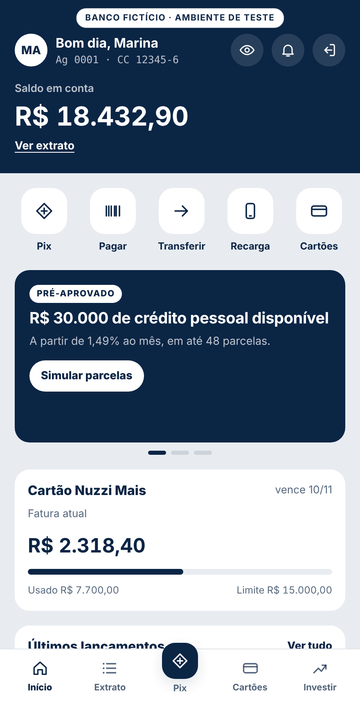
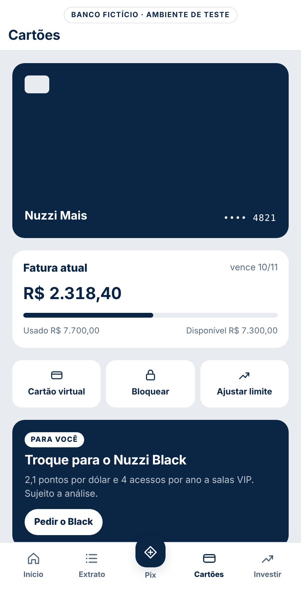

# Banco Nuzzi · laboratório de tagueamento

App de um banco **fictício** para testar tagueamento, `dataLayer` e Google Tag Manager num fluxo de app bancário:

1. **Tela de acesso** (deslogada): conta salva, atalhos públicos e carrossel de banners.
2. **Senha**: teclado numérico de 6 dígitos.
3. **Área logada** com abas: Início, Extrato, Pix, Cartões e Investimentos.

O app inteiro roda num único `index.html`, sem backend e sem dependências, com só três cores: azul-marinho, cinza-claro e branco. Nada do que é digitado sai do navegador.

| Acesso | Início | Cartões |
| --- | --- | --- |
|  |  |  |

> Ambiente de demonstração. Não insira dados reais.

## Como usar

1. Acesse https://thiagostino.github.io/banco-nuzzi-tagueamento/ (GitHub Pages, branch `main`, pasta `/`) ou abra `index.html` no navegador.
2. Para ver cada push no momento em que dispara, abra `index-datalayer.html`: é o mesmo app, com o painel do dataLayer ao lado. Cada evento aparece com a regra de disparo do plano e o ID do elemento do mapa que o gerou (EL-01 a EL-71). O `index.html` fica limpo, sem painel, para testar com o GTM.
3. Na senha, qualquer sequência de 6 dígitos entra. `000000` simula senha incorreta.

Cada tela é uma página virtual com rota por `#hash` (`#acesso`, `#entrar`, `#inicio`, `#extrato`, `#pix`, `#cartoes`, `#investimentos`) e gera um `page_view`.

## GA4 (ativo)

O app envia os eventos direto para a propriedade GA4 do laboratório (`G-RKQL0CT1PS`) com o gtag.js no `<head>`. A função `track()` faz o push no `dataLayer` e manda o mesmo evento, com os mesmos parâmetros, para o GA4:

- **Página virtual.** Cada `page_view` vai com `page_location` virtual (`.../banco-nuzzi-tagueamento/inicio`, `/pix`...), porque o GA4 descarta o `#hash` do caminho da página. A tag Google tem `send_page_view` desligado.
- **user_id.** O `user_id` pseudonimizado vira campo do GA4 no `login` e é limpo depois do `logout`.
- **Sem sinais de anúncio.** O modo de consentimento nega anúncios, e Google Signals e personalização de anúncios ficam desligados.
- **DebugView.** Abra o app com `?debug=1` na URL para ver os eventos no DebugView do GA4.

No fluxo de dados Web da propriedade, em **Medição otimizada**, desligue:

- **Interações com formulários**: o GA4 dispararia um `form_start` automático, com outros parâmetros, em cima do `form_start` do plano.
- **Visualizações de página → Mudanças de página com base em eventos do histórico do navegador**: a troca de `#hash` geraria `page_view` duplicado.

Para os parâmetros aparecerem nos relatórios, registre cada um como **dimensão personalizada** (escopo de evento), conforme a aba GA4 da planilha.

## Alternativa: aplicar o tagueamento pelo GTM

1. No Google Tag Manager, vá em **Administrador → Importar contêiner** e escolha `gtm/container-banco-nuzzi.json`. Use **Mesclar** num espaço de trabalho novo. A variável **GA4 · ID de métricas** já vem com `G-RKQL0CT1PS`.
2. Remova o bloco do gtag.js do `<head>` do `index.html` e cole o snippet do seu contêiner no comentário reservado. Com os dois ativos, cada evento chega duas vezes no GA4.
3. Abra o **Modo de visualização** do GTM e siga as jornadas da aba Jornadas da planilha.

O contêiner traz uma tag Google com `send_page_view` desligado, porque o app envia o próprio `page_view` a cada troca de tela. Para cada evento do plano, há um acionador de evento personalizado e uma tag de evento GA4 com os parâmetros documentados.

## Tracking plan

A fonte única é `tracking-plan/tracking-plan.json`, num formato inspirado no tracking plan do [instrument-events da Amplitude](https://github.com/amplitude/mcp-marketplace). Cada evento é documentado respondendo três perguntas: **o que ele significa**, **quando ele dispara** e **com o que ele se conecta**. O plano também separa os dois usos do dado pela IA: **responder perguntas** e **tomar decisões**.

A descrição de cada evento segue seis partes, nesta ordem:

1. O que o cliente fez.
2. Quando dispara.
3. Diferença para eventos parecidos.
4. Uso em análise.
5. Propriedades principais.
6. Detalhes técnicos.

| Grupo | Eventos |
| --- | --- |
| Navegação | `page_view`, `select_content` |
| Banners | `view_promotion`, `select_promotion`, `carousel_navigate` |
| Login | `auth_required`, `form_start`, `login_error`, `login`, `logout` |
| Área logada | `toggle_balance`, `statement_filter`, `quick_action`, `offer_click` |
| Produto | `card_request`, `investment_intent`, `generate_lead` |
| Pix | `pix_start`, `pix_error`, `pix_review`, `pix_edit`, `pix_success`, `pix_restart` |

O **mapa de tagueamento** (`catalogs.tagMap` no JSON, aba Mapa de tagueamento na planilha e seção Mapa por tela em `tracking-plan/eventos.md`) liga cada tela e cada elemento do app aos eventos que ele dispara, em ordem, com os valores fixos enviados. Cada linha do mapa tem um ID (EL-01 a EL-71) e um print do app com o elemento destacado, em `docs/prints/` (tela inteira) e `docs/prints/recorte/` (recorte centrado no elemento), gerados por `tools/gerar_prints.py`. Na planilha Excel, o print fica embutido na própria linha. O validador falha se um elemento com `data-track` ou `data-promo` ficar fora do mapa ou se faltar o print.

## Estrutura

```
index.html                                   app completo (HTML, CSS e JS)
index-datalayer.html                         o mesmo app com o painel do dataLayer ao lado (gerado)
AGENTS.md                                    instruções para agentes de IA
tracking-plan/tracking-plan.json             fonte única do tagueamento
tracking-plan/tracking-plan.schema.json      esquema do JSON
tracking-plan/contexto-ia.md                 glossário, funis, métricas e regras gerais
tracking-plan/eventos.md                     documentação legível (gerada)
gtm/container-banco-nuzzi.json               contêiner para importar no GTM (gerado)
docs/plano-de-tagueamento-banco-nuzzi.xlsx   planilha (gerada)
docs/telas/                                  imagem de cada tela do app
docs/prints/                                 print de cada elemento do mapa, destacado (gerado)
tools/gerar_artefatos.py                     gera os arquivos derivados a partir do JSON
tools/validar_plano.py                       confere o plano contra o código
tools/gerar_prints.py                        gera os prints dos elementos (Playwright)
.claude-plugin/marketplace.json              catálogo do plugin para agentes
plugins/banco-nuzzi-tagueamento/skills/      skills de taxonomia, instrumentação e auditoria
```

## Fluxo de mudança

```bash
# 1. altere o index.html e o tracking-plan.json
python3 tools/gerar_prints.py      # refaz os prints quando o visual mudar
python3 tools/gerar_artefatos.py   # atualiza linhas do código, index-datalayer.html, eventos.md, GTM e planilha
python3 tools/validar_plano.py     # precisa terminar com OK
```

## Plugin para agentes

Como o repositório da Amplitude, este repositório funciona como catálogo de plugin. No Claude Code:

```
/plugin marketplace add <seu-usuario>/<este-repositorio>
/plugin install banco-nuzzi-tagueamento@banco-nuzzi
```

Assim as skills `taxonomia`, `instrumentar-eventos` e `auditar-tagueamento` ficam disponíveis para o agente.

## Governança

- Nenhum dado pessoal ou financeiro do cliente entra no `dataLayer`. O `user_id` é pseudonimizado.
- Senha, agência, conta, saldo, fatura e chave Pix nunca são enviados. Do Pix vai só o tipo da chave (`pix_key_type`).
- Cartões com valores na tela usam `data-track-text`, para que o `link_text` não leve a fatura ou o saldo.
- Parâmetros opcionais vão como `undefined`, para o GTM não reaproveitar o valor de um evento anterior.

Banco Nuzzi é uma marca inventada para testes. Taxas, produtos, CNPJ e pessoas do extrato são fictícios.
