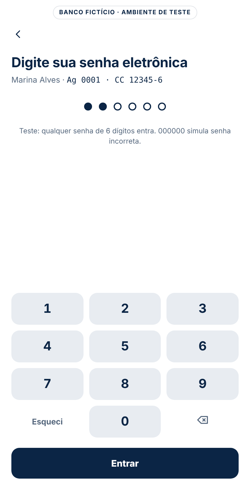
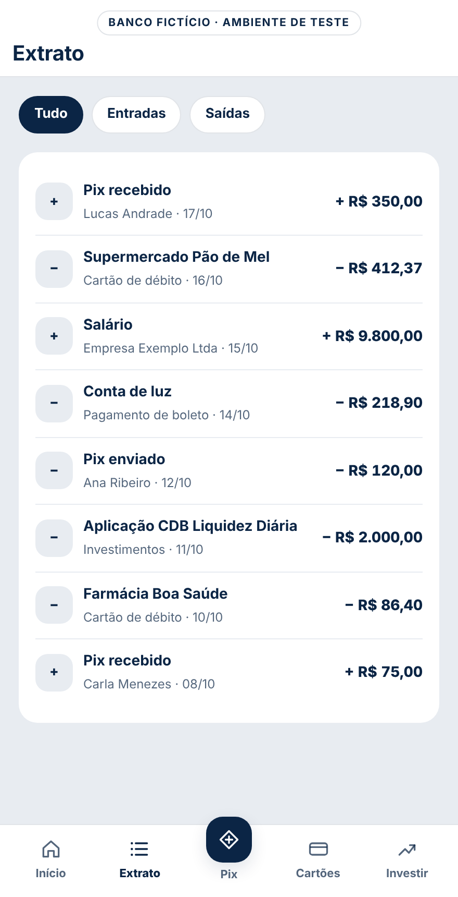
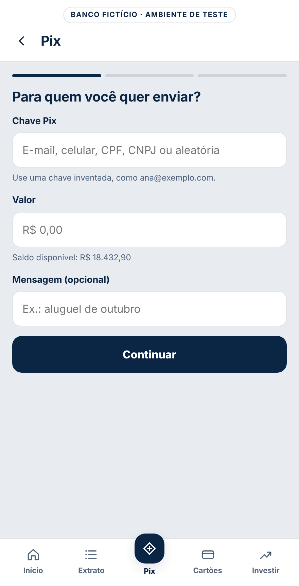
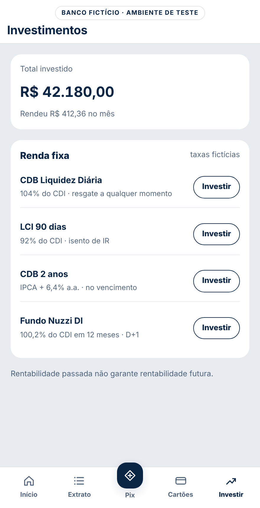

# Eventos do Banco Nuzzi

Versão 1.0.0 · atualizado em 2026-10-18 · gerado de `tracking-plan.json` por `tools/gerar_artefatos.py`.

Cada evento responde o que ele significa, quando ele dispara e com o que ele se conecta, e separa os dois usos do dado pela IA: responder perguntas e tomar decisões.

| Evento | Categoria | Quando dispara | Status |
| --- | --- | --- | --- |
| [`page_view`](#page_view) | Navegação | Ao abrir o app e a cada troca de #hash, depois da checagem de login. | Implementado |
| [`view_promotion`](#view_promotion) | Banners | Quando ao menos 60% do banner fica visível (IntersectionObserver), inclusive ao arrastar o carrossel até ele. | Implementado |
| [`select_promotion`](#select_promotion) | Banners | No toque em .promo-cta dentro de [data-promo]. | Implementado |
| [`carousel_navigate`](#carousel_navigate) | Banners | Quando o cliente arrasta o carrossel e a rolagem para em outro banner, ou toca num indicador (.dot). | Implementado |
| [`select_content`](#select_content) | Navegação | No toque em qualquer elemento com data-track. | Implementado |
| [`auth_required`](#auth_required) | Login | Ao abrir uma tela logada deslogado: pelo atalho Pix da tela de acesso, pelos banners de Cartões e Investimentos ou por link direto. | Implementado |
| [`form_start`](#form_start) | Login | No primeiro dígito da senha (teclado da tela ou do computador), uma vez a cada visita a /entrar. | Implementado |
| [`login_error`](#login_error) | Login | No toque em Entrar com menos de 6 dígitos (senha_incompleta) ou com a senha 000000, que simula senha incorreta (senha_incorreta). | Implementado |
| [`login`](#login) | Login | No toque em Entrar com 6 dígitos aceitos, antes de ir para o destino guardado (ou /inicio). | Implementado |
| [`logout`](#logout) | Login | No toque no ícone Sair (#btn-sair), no topo do Início. | Implementado |
| [`toggle_balance`](#toggle_balance) | Área logada | No toque no ícone de olho (#btn-saldo), no topo do Início. | Implementado |
| [`statement_filter`](#statement_filter) | Área logada | No toque num filtro do extrato (Tudo, Entradas, Saídas) diferente do filtro atual. | Implementado |
| [`quick_action`](#quick_action) | Área logada | No toque em Ajuda, Trocar conta, Token, Bloquear cartão, Esqueci, Notificações, Pagar, Transferir, Recarga, Cartão virtual ou Ajustar limite. | Implementado |
| [`offer_click`](#offer_click) | Área logada | No toque em 'Simular parcelas' ou 'Contratar seguro' nos banners do Início, logo depois de select_promotion. | Ajustar |
| [`card_request`](#card_request) | Produto | No toque em 'Pedir o Black' (banner, logo depois de select_promotion) ou em 'Pedir adicional' na tela Cartões. | Implementado |
| [`investment_intent`](#investment_intent) | Produto | No toque em Investir num produto da tela Investimentos. | Implementado |
| [`generate_lead`](#generate_lead) | Produto | No toque em 'Abrir conta' (atalho) ou 'Quero abrir' (banner, logo depois de select_promotion) na tela de acesso. | Implementado |
| [`pix_start`](#pix_start) | Pix | No primeiro foco em qualquer campo de #pix-form, uma vez a cada abertura do Pix. | Implementado |
| [`pix_error`](#pix_error) | Pix | No toque em Continuar sem chave, com valor zero ou inválido, ou acima do saldo. | Implementado |
| [`pix_review`](#pix_review) | Pix | No toque em Continuar com chave e valor válidos. | Implementado |
| [`pix_edit`](#pix_edit) | Pix | No toque em 'Corrigir dados' (#pix-corrigir). | Implementado |
| [`pix_success`](#pix_success) | Pix | No toque em 'Confirmar Pix' (#pix-confirmar), depois de debitar o saldo e gerar o identificador. | Implementado |
| [`pix_restart`](#pix_restart) | Pix | No toque em 'Fazer outro Pix' (#pix-novo). | Implementado |

## Mapa por tela

Cada elemento do app e os eventos que ele dispara, em ordem. Imagens das telas em `docs/telas/`.


### /acesso


| ID | Área | Elemento | Seletor | Gesto | Eventos | Valores fixos | Print |
| --- | --- | --- | --- | --- | --- | --- | --- |
| EL-01 | Tela inteira | Tela de acesso | `[data-page=acesso]` | Abrir o app deslogado | page_view | page_path=/acesso · page_type=publico · login_status=logged_out | [ver](../docs/prints/EL-01.jpg) |
| EL-02 | Topo | Ícone de ajuda (?) | `[data-action=quick_action][data-item=ajuda]` | Toque | quick_action | action_id=ajuda · page_path=/acesso | [ver](../docs/prints/EL-02.jpg) |
| EL-03 | Conta salva | Link Trocar | `[data-item=trocar_conta]` | Toque | quick_action | action_id=trocar_conta · page_path=/acesso | [ver](../docs/prints/EL-03.jpg) |
| EL-04 | Botão principal | Acessar minha conta | `[data-track=acesso_entrar]` | Toque | select_content → page_view | item_id=acesso_entrar · content_type=cta · depois page_path=/entrar | [ver](../docs/prints/EL-04.jpg) |
| EL-05 | Atalhos | Pix | `[data-track=acesso_pix]` | Toque | select_content → auth_required → page_view | item_id=acesso_pix · target_path=/pix · depois page_path=/entrar | [ver](../docs/prints/EL-05.jpg) |
| EL-06 | Atalhos | Token | `[data-item=token]` | Toque | quick_action | action_id=token · page_path=/acesso | [ver](../docs/prints/EL-06.jpg) |
| EL-07 | Atalhos | Bloquear cartão | `[data-item=bloquear_cartao]` | Toque | quick_action | action_id=bloquear_cartao · page_path=/acesso | [ver](../docs/prints/EL-07.jpg) |
| EL-08 | Atalhos | Abrir conta | `[data-action=lead]` | Toque | generate_lead | lead_type=abertura_conta · page_path=/acesso | [ver](../docs/prints/EL-08.jpg) |
| EL-09 | Carrossel Para você | Indicadores e arrasto | `[data-carousel=acesso_destaques]` | Arrastar ou tocar no indicador | carousel_navigate | carousel_id=acesso_destaques · control=arrastar ou indicador | [ver](../docs/prints/EL-09.jpg) |
| EL-10 | Carrossel Para você | Banner Abra sua conta | `[data-promo=bnr_abra_conta]` | Aparecer 60% na tela | view_promotion | promotion_id=bnr_abra_conta · creative_slot=acesso_destaque_1 | [ver](../docs/prints/EL-10.jpg) |
| EL-11 | Carrossel Para você | Botão Quero abrir | `[data-promo=bnr_abra_conta] .promo-cta` | Toque | select_promotion → generate_lead | promotion_id=bnr_abra_conta · lead_type=abertura_conta | [ver](../docs/prints/EL-11.jpg) |
| EL-12 | Carrossel Para você | Banner Nuzzi Black | `[data-promo=bnr_cartao_black]` | Aparecer 60% na tela | view_promotion | promotion_id=bnr_cartao_black · creative_slot=acesso_destaque_2 | [ver](../docs/prints/EL-12.jpg) |
| EL-13 | Carrossel Para você | Botão Conhecer o Black | `[data-promo=bnr_cartao_black] .promo-cta` | Toque | select_promotion → auth_required → page_view | promotion_id=bnr_cartao_black · target_path=/cartoes · depois page_path=/entrar | [ver](../docs/prints/EL-13.jpg) |
| EL-14 | Carrossel Para você | Banner CDB 104% do CDI | `[data-promo=bnr_cdb_liquidez]` | Aparecer 60% na tela | view_promotion | promotion_id=bnr_cdb_liquidez · creative_slot=acesso_destaque_3 | [ver](../docs/prints/EL-14.jpg) |
| EL-15 | Carrossel Para você | Botão Ver investimentos | `[data-promo=bnr_cdb_liquidez] .promo-cta` | Toque | select_promotion → auth_required → page_view | promotion_id=bnr_cdb_liquidez · target_path=/investimentos · depois page_path=/entrar | [ver](../docs/prints/EL-15.jpg) |

### /entrar



| ID | Área | Elemento | Seletor | Gesto | Eventos | Valores fixos | Print |
| --- | --- | --- | --- | --- | --- | --- | --- |
| EL-16 | Tela inteira | Tela de senha | `[data-page=entrar]` | Abrir | page_view | page_path=/entrar · page_type=login | [ver](../docs/prints/EL-16.jpg) |
| EL-17 | Topo | Seta Voltar | `[data-track=senha_voltar]` | Toque | select_content → page_view | item_id=senha_voltar · link_text=Voltar · depois page_path=/acesso | [ver](../docs/prints/EL-17.jpg) |
| EL-18 | Teclado | Teclas de 0 a 9 | `#keypad [data-key]` | Primeiro dígito | form_start | form_id=login · page_path=/entrar | [ver](../docs/prints/EL-18.jpg) |
| EL-19 | Teclado | Esqueci | `[data-item=esqueci_senha]` | Toque | quick_action | action_id=esqueci_senha · page_path=/entrar | [ver](../docs/prints/EL-19.jpg) |
| EL-20 | Botão | Entrar com menos de 6 dígitos | `#btn-entrar` | Toque | login_error | form_id=login · error_type=senha_incompleta | [ver](../docs/prints/EL-20.jpg) |
| EL-21 | Botão | Entrar com 000000 | `#btn-entrar` | Toque | login_error | form_id=login · error_type=senha_incorreta | [ver](../docs/prints/EL-21.jpg) |
| EL-22 | Botão | Entrar com 6 dígitos | `#btn-entrar` | Toque | login → page_view | method=senha_eletronica · user_id=u_8f2c41a9 · depois page_path do destino | [ver](../docs/prints/EL-22.jpg) |

### /inicio


| ID | Área | Elemento | Seletor | Gesto | Eventos | Valores fixos | Print |
| --- | --- | --- | --- | --- | --- | --- | --- |
| EL-23 | Tela inteira | Início | `[data-page=inicio]` | Abrir | page_view | page_path=/inicio · page_type=area_logada · user_id | [ver](../docs/prints/EL-23.jpg) |
| EL-24 | Topo | Ícone de olho | `#btn-saldo` | Toque | toggle_balance | state=hidden ou visible | [ver](../docs/prints/EL-24.jpg) |
| EL-25 | Topo | Sino de notificações | `[data-item=notificacoes]` | Toque | quick_action | action_id=notificacoes · page_path=/inicio | [ver](../docs/prints/EL-25.jpg) |
| EL-26 | Topo | Ícone Sair | `#btn-sair` | Toque | logout → page_view | user_id · depois page_path=/acesso · login_status=logged_out | [ver](../docs/prints/EL-26.jpg) |
| EL-27 | Saldo | Ver extrato | `[data-track=inicio_ver_extrato]` | Toque | select_content → page_view | item_id=inicio_ver_extrato · depois page_path=/extrato | [ver](../docs/prints/EL-27.jpg) |
| EL-28 | Atalhos | Pix | `[data-track=atalho_pix]` | Toque | select_content → page_view | item_id=atalho_pix · content_type=shortcut · depois page_path=/pix | [ver](../docs/prints/EL-28.jpg) |
| EL-29 | Atalhos | Pagar | `[data-item=pagar_boleto]` | Toque | quick_action | action_id=pagar_boleto · page_path=/inicio | [ver](../docs/prints/EL-29.jpg) |
| EL-30 | Atalhos | Transferir | `[data-item=transferir]` | Toque | quick_action | action_id=transferir · page_path=/inicio | [ver](../docs/prints/EL-30.jpg) |
| EL-31 | Atalhos | Recarga | `[data-item=recarga]` | Toque | quick_action | action_id=recarga · page_path=/inicio | [ver](../docs/prints/EL-31.jpg) |
| EL-32 | Atalhos | Cartões | `[data-track=atalho_cartoes]` | Toque | select_content → page_view | item_id=atalho_cartoes · depois page_path=/cartoes | [ver](../docs/prints/EL-32.jpg) |
| EL-33 | Atalhos | Investir | `[data-track=atalho_investir]` | Toque | select_content → page_view | item_id=atalho_investir · depois page_path=/investimentos | [ver](../docs/prints/EL-33.jpg) |
| EL-34 | Carrossel de ofertas | Indicadores e arrasto | `[data-carousel=inicio_ofertas]` | Arrastar ou tocar no indicador | carousel_navigate | carousel_id=inicio_ofertas · control=arrastar ou indicador | [ver](../docs/prints/EL-34.jpg) |
| EL-35 | Carrossel de ofertas | Banner Crédito pré-aprovado | `[data-promo=bnr_credito_preaprovado]` | Aparecer 60% na tela | view_promotion | promotion_id=bnr_credito_preaprovado · creative_slot=inicio_oferta_1 | [ver](../docs/prints/EL-35.jpg) |
| EL-36 | Carrossel de ofertas | Botão Simular parcelas | `[data-promo=bnr_credito_preaprovado] .promo-cta` | Toque | select_promotion → offer_click | promotion_id=bnr_credito_preaprovado · offer_id=credito_preaprovado | [ver](../docs/prints/EL-36.jpg) |
| EL-37 | Carrossel de ofertas | Banner Seguro cartão | `[data-promo=bnr_seguro_cartao]` | Aparecer 60% na tela | view_promotion | promotion_id=bnr_seguro_cartao · creative_slot=inicio_oferta_2 | [ver](../docs/prints/EL-37.jpg) |
| EL-38 | Carrossel de ofertas | Botão Contratar seguro | `[data-promo=bnr_seguro_cartao] .promo-cta` | Toque | select_promotion → offer_click | promotion_id=bnr_seguro_cartao · offer_id=seguro_cartao | [ver](../docs/prints/EL-38.jpg) |
| EL-39 | Carrossel de ofertas | Banner Pix agendado | `[data-promo=bnr_pix_agendado]` | Aparecer 60% na tela | view_promotion | promotion_id=bnr_pix_agendado · creative_slot=inicio_oferta_3 | [ver](../docs/prints/EL-39.jpg) |
| EL-40 | Carrossel de ofertas | Botão Agendar um Pix | `[data-promo=bnr_pix_agendado] .promo-cta` | Toque | select_promotion → page_view | promotion_id=bnr_pix_agendado · depois page_path=/pix | [ver](../docs/prints/EL-40.jpg) |
| EL-41 | Cartão da fatura | Cartão Nuzzi Mais (fatura) | `[data-track=inicio_card_fatura]` | Toque | select_content → page_view | item_id=inicio_card_fatura · link_text=Cartão Nuzzi Mais · depois page_path=/cartoes | [ver](../docs/prints/EL-41.jpg) |
| EL-42 | Últimos lançamentos | Ver tudo | `[data-track=inicio_extrato_completo]` | Toque | select_content → page_view | item_id=inicio_extrato_completo · depois page_path=/extrato | [ver](../docs/prints/EL-42.jpg) |
| EL-43 | Investimentos | Cartão de investimentos | `[data-track=inicio_card_investimentos]` | Toque | select_content → page_view | item_id=inicio_card_investimentos · link_text=Investimentos · depois page_path=/investimentos | [ver](../docs/prints/EL-43.jpg) |

### /extrato



| ID | Área | Elemento | Seletor | Gesto | Eventos | Valores fixos | Print |
| --- | --- | --- | --- | --- | --- | --- | --- |
| EL-44 | Tela inteira | Extrato | `[data-page=extrato]` | Abrir | page_view | page_path=/extrato | [ver](../docs/prints/EL-44.jpg) |
| EL-45 | Filtros | Tudo, Entradas, Saídas | `[data-filter]` | Toque num filtro diferente do atual | statement_filter | filter=todos, entradas ou saidas | [ver](../docs/prints/EL-45.jpg) |

### /pix



| ID | Área | Elemento | Seletor | Gesto | Eventos | Valores fixos | Print |
| --- | --- | --- | --- | --- | --- | --- | --- |
| EL-46 | Tela inteira | Pix | `[data-page=pix]` | Abrir | page_view | page_path=/pix | [ver](../docs/prints/EL-46.jpg) |
| EL-47 | Topo | Seta Voltar | `[data-track=pix_voltar]` | Toque | select_content → page_view | item_id=pix_voltar · depois page_path=/inicio | [ver](../docs/prints/EL-47.jpg) |
| EL-48 | Etapa 1 · Dados | Campos chave, valor e mensagem | `#pix-form` | Primeiro foco num campo | pix_start | page_path=/pix | [ver](../docs/prints/EL-48.jpg) |
| EL-49 | Etapa 1 · Dados | Botão Continuar com erro | `#pix-form [type=submit]` | Toque | pix_error | error_type=chave_vazia, valor_invalido ou saldo_insuficiente | [ver](../docs/prints/EL-49.jpg) |
| EL-50 | Etapa 1 · Dados | Botão Continuar válido | `#pix-form [type=submit]` | Toque | pix_review | value · currency=BRL · pix_key_type | [ver](../docs/prints/EL-50.jpg) |
| EL-51 | Etapa 2 · Revisão | Botão Confirmar Pix | `#pix-confirmar` | Toque | pix_success | transaction_id · value · currency=BRL · pix_key_type | [ver](../docs/prints/EL-51.jpg) |
| EL-52 | Etapa 2 · Revisão | Botão Corrigir dados | `#pix-corrigir` | Toque | pix_edit | step=revisao | [ver](../docs/prints/EL-52.jpg) |
| EL-53 | Etapa 3 · Comprovante | Voltar ao início | `[data-track=pix_comprovante_inicio]` | Toque | select_content → page_view | item_id=pix_comprovante_inicio · depois page_path=/inicio | [ver](../docs/prints/EL-53.jpg) |
| EL-54 | Etapa 3 · Comprovante | Fazer outro Pix | `#pix-novo` | Toque | pix_restart | (nenhum parâmetro) | [ver](../docs/prints/EL-54.jpg) |

### /cartoes


| ID | Área | Elemento | Seletor | Gesto | Eventos | Valores fixos | Print |
| --- | --- | --- | --- | --- | --- | --- | --- |
| EL-55 | Tela inteira | Cartões | `[data-page=cartoes]` | Abrir | page_view | page_path=/cartoes | [ver](../docs/prints/EL-55.jpg) |
| EL-56 | Ações do cartão | Cartão virtual | `[data-item=cartao_virtual]` | Toque | quick_action | action_id=cartao_virtual · page_path=/cartoes | [ver](../docs/prints/EL-56.jpg) |
| EL-57 | Ações do cartão | Bloquear | `[data-item=bloquear_cartao]` | Toque | quick_action | action_id=bloquear_cartao · page_path=/cartoes | [ver](../docs/prints/EL-57.jpg) |
| EL-58 | Ações do cartão | Ajustar limite | `[data-item=ajustar_limite]` | Toque | quick_action | action_id=ajustar_limite · page_path=/cartoes | [ver](../docs/prints/EL-58.jpg) |
| EL-59 | Oferta | Banner Troque para o Nuzzi Black | `[data-promo=bnr_upgrade_black]` | Aparecer 60% na tela | view_promotion | promotion_id=bnr_upgrade_black · creative_slot=cartoes_oferta_1 | [ver](../docs/prints/EL-59.jpg) |
| EL-60 | Oferta | Botão Pedir o Black | `[data-promo=bnr_upgrade_black] .promo-cta` | Toque | select_promotion → card_request | promotion_id=bnr_upgrade_black · card_tier=black | [ver](../docs/prints/EL-60.jpg) |
| EL-61 | Cartão adicional | Botão Pedir adicional | `[data-action=card_request][data-item=adicional]` | Toque | card_request | card_tier=adicional | [ver](../docs/prints/EL-61.jpg) |

### /investimentos



| ID | Área | Elemento | Seletor | Gesto | Eventos | Valores fixos | Print |
| --- | --- | --- | --- | --- | --- | --- | --- |
| EL-62 | Tela inteira | Investimentos | `[data-page=investimentos]` | Abrir | page_view | page_path=/investimentos | [ver](../docs/prints/EL-62.jpg) |
| EL-63 | Renda fixa | Investir · CDB Liquidez Diária | `[data-item=cdb_liquidez]` | Toque | investment_intent | product_id=cdb_liquidez | [ver](../docs/prints/EL-63.jpg) |
| EL-64 | Renda fixa | Investir · LCI 90 dias | `[data-item=lci_90]` | Toque | investment_intent | product_id=lci_90 | [ver](../docs/prints/EL-64.jpg) |
| EL-65 | Renda fixa | Investir · CDB 2 anos | `[data-item=cdb_ipca_2a]` | Toque | investment_intent | product_id=cdb_ipca_2a | [ver](../docs/prints/EL-65.jpg) |
| EL-66 | Renda fixa | Investir · Fundo Nuzzi DI | `[data-item=fundo_di]` | Toque | investment_intent | product_id=fundo_di | [ver](../docs/prints/EL-66.jpg) |

### Telas logadas

| ID | Área | Elemento | Seletor | Gesto | Eventos | Valores fixos | Print |
| --- | --- | --- | --- | --- | --- | --- | --- |
| EL-67 | Barra de abas | Início | `[data-track=tab_inicio]` | Toque | select_content → page_view | item_id=tab_inicio · content_type=tab_bar · depois page_path=/inicio | [ver](../docs/prints/EL-67.jpg) |
| EL-68 | Barra de abas | Extrato | `[data-track=tab_extrato]` | Toque | select_content → page_view | item_id=tab_extrato · depois page_path=/extrato | [ver](../docs/prints/EL-68.jpg) |
| EL-69 | Barra de abas | Pix | `[data-track=tab_pix]` | Toque | select_content → page_view | item_id=tab_pix · depois page_path=/pix | [ver](../docs/prints/EL-69.jpg) |
| EL-70 | Barra de abas | Cartões | `[data-track=tab_cartoes]` | Toque | select_content → page_view | item_id=tab_cartoes · depois page_path=/cartoes | [ver](../docs/prints/EL-70.jpg) |
| EL-71 | Barra de abas | Investir | `[data-track=tab_investir]` | Toque | select_content → page_view | item_id=tab_investir · depois page_path=/investimentos | [ver](../docs/prints/EL-71.jpg) |

## page_view

**O que é.** O cliente passou a ver uma tela do app. Cada tela é uma página virtual (rota por #hash).

**Quando dispara.** Ao abrir o app e a cada troca de #hash, depois da checagem de login. Sem #hash, abre /acesso (deslogado) ou /inicio (logado). Se a tela exige login e o cliente está deslogado, dispara para /entrar, e não para a tela pedida.

**Diferença para eventos parecidos.** Registra a tela vista. O clique que levou até ela é select_content ou select_promotion.

**Uso em análise.** Base de todos os funis por tela e denominador das taxas por tela.

**Com o que se conecta.** Cliente (user_id, quando logado) · Tela (page_path) · Estado de login

**Uso pela IA**

- Para responder perguntas: Quantos clientes logados abriram a tela de Pix nesta semana?
- Para tomar decisões: Escolher o conteúdo e as ofertas da tela conforme page_type e login_status.

**Código do dataLayer**

```js
// Quando: Ao abrir o app e a cada troca de #hash, depois da checagem de login.
window.dataLayer.push({
  event: 'page_view',
  page_path: '/inicio',
  page_title: 'Início',
  page_type: 'area_logada',
  login_status: 'logged_in',
  user_id: 'u_8f2c41a9'
});
```

| Parâmetro | Tipo | Obrigatório | Significado | Valores | LGPD |
| --- | --- | --- | --- | --- | --- |
| `page_path` | string | Sim | Tela vista, no formato /rota. | /acesso, /entrar, /inicio, /extrato, /pix, /cartoes, /investimentos | Não pessoal |
| `page_title` | string | Sim | Nome da tela para leitura humana. | Acesso, Senha, Início, Extrato, Pix, Cartões, Investimentos | Não pessoal |
| `page_type` | string | Sim | Tipo de tela, para agrupar análises. | publico, login, area_logada | Não pessoal |
| `login_status` | string | Sim | Se o cliente estava logado ao ver a tela. | logged_in, logged_out | Não pessoal |
| `user_id` | string | Só logado | Identificador pseudonimizado do cliente. Liga eventos ao mesmo cliente sem expor quem ele é. Deslogado, vai como undefined. | u_ + hash | Pseudonimizado |

**Onde está no código**

- `index.html`, linha 570, route(), depois de mostrar a tela: `track('page_view', { page_path: '/' + r, page_title: ROUTES[r].title, page_type: ROUTES[r].type, login_status: S.logged ? 'logged_in' : 'logged_out', user_id: S.logged ? S.user.id : undefined })`

**Elementos no app.** EL-01, EL-04, EL-05, EL-13, EL-15, EL-16, EL-17, EL-22, EL-23, EL-26, EL-27, EL-28, EL-32, EL-33, EL-40, EL-41, EL-42, EL-43, EL-44, EL-46, EL-47, EL-53, EL-55, EL-62, EL-67, EL-68, EL-69, EL-70, EL-71 (ver Mapa por tela).


**GTM.** Acionador `CE · page_view`, tag `GA4 · page_view`. Owner: Governança de Dados Digitais.

## view_promotion

**O que é.** Um banner interno apareceu de fato na tela do cliente. Mede exposição, não carregamento.

**Quando dispara.** Quando ao menos 60% do banner fica visível (IntersectionObserver), inclusive ao arrastar o carrossel até ele. Uma vez por banner a cada page_view.

**Diferença para eventos parecidos.** Exposição do banner, não clique (select_promotion). Não conta carregamento da página: o banner precisa aparecer na tela.

**Uso em análise.** Denominador da taxa de clique de banner (CTR) por promotion_id e creative_slot.

**Com o que se conecta.** Banner (promotion_id, catálogo na aba Banners) · Posição (creative_slot) · Tela (location_id)

**Uso pela IA**

- Para responder perguntas: Qual banner da tela de acesso foi mais visto ontem, e em qual posição?
- Para tomar decisões: Decidir qual banner mostrar primeiro, usando select_promotion como resultado.

**Código do dataLayer**

```js
// Quando: Quando ao menos 60% do banner fica visível (IntersectionObserver), inclusive ao arrastar o carrossel até ele.
window.dataLayer.push({
  event: 'view_promotion',
  promotion_id: 'bnr_credito_preaprovado',
  promotion_name: 'Crédito pessoal pré-aprovado',
  creative_slot: 'inicio_oferta_1',
  location_id: '/inicio'
});
```

| Parâmetro | Tipo | Obrigatório | Significado | Valores | LGPD |
| --- | --- | --- | --- | --- | --- |
| `promotion_id` | string | Sim | Código do banner no catálogo de campanhas. | Ver aba Banners | Não pessoal |
| `promotion_name` | string | Sim | Nome do banner para leitura humana. | Ver aba Banners | Não pessoal |
| `creative_slot` | string | Sim | Posição do banner na tela. | Ver aba Banners | Não pessoal |
| `location_id` | string | Sim | Tela onde o banner estava. | /acesso, /inicio, /cartoes | Não pessoal |

**Onde está no código**

- `index.html`, linha 589, impression(), chamada pelo IntersectionObserver: `track('view_promotion', promoData(el))`

**Elementos no app.** EL-10, EL-12, EL-14, EL-35, EL-37, EL-39, EL-59 (ver Mapa por tela).


**GTM.** Acionador `CE · view_promotion`, tag `GA4 · view_promotion`. Owner: Marketing Digital.

## select_promotion

**O que é.** O cliente tocou no botão de um banner interno.

**Quando dispara.** No toque em .promo-cta dentro de [data-promo]. Dispara antes da troca de tela e antes do evento da ação do botão (generate_lead, offer_click ou card_request).

**Diferença para eventos parecidos.** Só botões dentro de um banner [data-promo]. Links comuns são select_content. offer_click e generate_lead registram a intenção específica no mesmo clique.

**Uso em análise.** Numerador do CTR de banner e início dos funis de campanha.

**Com o que se conecta.** Banner (promotion_id) · Posição (creative_slot) · Tela (location_id)

**Uso pela IA**

- Para responder perguntas: Qual a taxa de toque do banner de crédito pré-aprovado?
- Para tomar decisões: Pausar ou trocar banner com taxa de toque baixa.

**Código do dataLayer**

```js
// Quando: No toque em .promo-cta dentro de [data-promo].
window.dataLayer.push({
  event: 'select_promotion',
  promotion_id: 'bnr_credito_preaprovado',
  promotion_name: 'Crédito pessoal pré-aprovado',
  creative_slot: 'inicio_oferta_1',
  location_id: '/inicio'
});
```

| Parâmetro | Tipo | Obrigatório | Significado | Valores | LGPD |
| --- | --- | --- | --- | --- | --- |
| `promotion_id` | string | Sim | Código do banner no catálogo de campanhas. | Ver aba Banners | Não pessoal |
| `promotion_name` | string | Sim | Nome do banner para leitura humana. | Ver aba Banners | Não pessoal |
| `creative_slot` | string | Sim | Posição do banner na tela. | Ver aba Banners | Não pessoal |
| `location_id` | string | Sim | Tela onde o banner estava. | /acesso, /inicio, /cartoes | Não pessoal |

**Onde está no código**

- `index.html`, linha 635, listener global de clique, ramo .promo-cta: `track('select_promotion', promoData(promoCta.closest('[data-promo]')))`

**Elementos no app.** EL-11, EL-13, EL-15, EL-36, EL-38, EL-40, EL-60 (ver Mapa por tela).


**GTM.** Acionador `CE · select_promotion`, tag `GA4 · select_promotion`. Owner: Marketing Digital.

## carousel_navigate

**O que é.** O cliente passou para outro banner do carrossel por conta própria.

**Quando dispara.** Quando o cliente arrasta o carrossel e a rolagem para em outro banner, ou toca num indicador (.dot). O arrasto dispara uma vez, no banner em que a rolagem parou.

**Diferença para eventos parecidos.** Mede a ação do cliente no controle do carrossel. A exposição do slide é view_promotion.

**Uso em análise.** Engajamento com os carrosséis da tela de acesso e do Início.

**Com o que se conecta.** Carrossel (carousel_id) · Banner exibido (promotion_id) · Ordem do banner

**Uso pela IA**

- Para responder perguntas: Os clientes passam do primeiro banner do Início ou ficam nele?
- Para tomar decisões: Definir a ordem dos banners em cada carrossel.

**Código do dataLayer**

```js
// Quando: Quando o cliente arrasta o carrossel e a rolagem para em outro banner, ou toca num indicador (.dot).
window.dataLayer.push({
  event: 'carousel_navigate',
  carousel_id: 'inicio_ofertas',
  control: 'arrastar',
  slide_index: 2,
  promotion_id: 'bnr_seguro_cartao'
});
```

| Parâmetro | Tipo | Obrigatório | Significado | Valores | LGPD |
| --- | --- | --- | --- | --- | --- |
| `carousel_id` | string | Sim | Carrossel em que o cliente navegou. | acesso_destaques, inicio_ofertas | Não pessoal |
| `control` | string | Sim | Como o cliente trocou de banner. | arrastar, indicador | Não pessoal |
| `slide_index` | number | Sim | Posição do banner exibido depois da troca, começando em 1. | 1 a 3 | Não pessoal |
| `promotion_id` | string | Sim | Banner exibido depois da troca. | Ver aba Banners | Não pessoal |

**Onde está no código**

- `index.html`, linha 614, clique num indicador (.dot) do carrossel: `track('carousel_navigate', { carousel_id: id, control: 'indicador', slide_index: i + 1, promotion_id: slides[i].getAttribute('data-promo') })`
- `index.html`, linha 626, fim da rolagem do carrossel (.track), quando não veio de um indicador: `track('carousel_navigate', { carousel_id: id, control: 'arrastar', slide_index: cur + 1, promotion_id: slides[cur].getAttribute('data-promo') })`

**Elementos no app.** EL-09, EL-34 (ver Mapa por tela).


**GTM.** Acionador `CE · carousel_navigate`, tag `GA4 · carousel_navigate`. Owner: Marketing Digital.

## select_content

**O que é.** O cliente tocou num elemento de navegação marcado para medição: aba, atalho com link, cartão ou botão.

**Quando dispara.** No toque em qualquer elemento com data-track. Dispara antes da troca de tela.

**Diferença para eventos parecidos.** Abas, atalhos com link, cartões e botões de navegação. Botões de banner são select_promotion; atalhos sem link são quick_action.

**Uso em análise.** Análise de navegação e caminhos entre telas.

**Com o que se conecta.** Elemento (item_id, aba Elementos) · Tela de origem (page_path)

**Uso pela IA**

- Para responder perguntas: Qual aba da barra inferior é mais usada depois do login?
- Para tomar decisões: Reordenar atalhos e abas pelo uso.

**Código do dataLayer**

```js
// Quando: No toque em qualquer elemento com data-track.
window.dataLayer.push({
  event: 'select_content',
  content_type: 'tab_bar',
  item_id: 'tab_extrato',
  link_text: 'Extrato',
  page_path: '/inicio'
});
```

| Parâmetro | Tipo | Obrigatório | Significado | Valores | LGPD |
| --- | --- | --- | --- | --- | --- |
| `content_type` | string | Sim | Tipo de elemento tocado. | cta, shortcut, tab_bar, card | Não pessoal |
| `item_id` | string | Sim | Código do elemento tocado. | Ver aba Elementos | Não pessoal |
| `link_text` | string | Sim | Texto do elemento, até 60 caracteres. Vem de data-track-text, aria-label ou texto visível, nessa ordem. | Texto fixo do app | Não pessoal (texto fixo) |
| `page_path` | string | Sim | Tela onde o toque aconteceu. | /acesso, /entrar, /inicio, /extrato, /pix, /cartoes, /investimentos | Não pessoal |

**Onde está no código**

- `index.html`, linha 638, listener global de clique, ramo [data-track]: `track('select_content', { content_type: t.getAttribute('data-track-type') || 'link', item_id: t.getAttribute('data-track'), link_text: (t.getAttribute('data-track-text') || t.getAttribute('aria-label') || t.textContent || '').replace(/\s+/g, ' ').trim().slice(0, 60), page_path: '/' + S.route })`

**Elementos no app.** EL-04, EL-05, EL-17, EL-27, EL-28, EL-32, EL-33, EL-41, EL-42, EL-43, EL-47, EL-53, EL-67, EL-68, EL-69, EL-70, EL-71 (ver Mapa por tela).


**GTM.** Acionador `CE · select_content`, tag `GA4 · select_content`. Owner: Produto Digital.

## auth_required

**O que é.** O cliente tentou abrir uma tela logada sem estar logado. O app guarda o destino e leva o cliente para lá depois do login.

**Quando dispara.** Ao abrir uma tela logada deslogado: pelo atalho Pix da tela de acesso, pelos banners de Cartões e Investimentos ou por link direto. Dispara antes do page_view de /entrar.

**Diferença para eventos parecidos.** O cliente ainda não tentou entrar, só pediu uma tela logada. Tentativa recusada é login_error.

**Uso em análise.** Topo do funil de login a partir de uma intenção (target_path).

**Com o que se conecta.** Destino desejado (target_path) · Tela de origem (page_path)

**Uso pela IA**

- Para responder perguntas: Para quais telas os clientes deslogados mais tentam ir?
- Para tomar decisões: Levar o cliente direto ao destino depois do login.

**Código do dataLayer**

```js
// Quando: Ao abrir uma tela logada deslogado: pelo atalho Pix da tela de acesso, pelos banners de Cartões e Investimentos ou por link direto.
window.dataLayer.push({
  event: 'auth_required',
  target_path: '/pix',
  page_path: '/acesso'
});
```

| Parâmetro | Tipo | Obrigatório | Significado | Valores | LGPD |
| --- | --- | --- | --- | --- | --- |
| `target_path` | string | Sim | Tela logada que o cliente queria abrir. | /inicio, /extrato, /pix, /cartoes, /investimentos | Não pessoal |
| `page_path` | string | Não | Tela de onde o cliente veio. Vai como undefined quando o app já abre numa tela logada. | /acesso, /entrar, /inicio, /extrato, /pix, /cartoes, /investimentos | Não pessoal |

**Onde está no código**

- `index.html`, linha 557, route(), tela logada aberta sem login: `track('auth_required', { target_path: '/' + r, page_path: S.route ? '/' + S.route : undefined })`

**Elementos no app.** EL-05, EL-13, EL-15 (ver Mapa por tela).


**GTM.** Acionador `CE · auth_required`, tag `GA4 · auth_required`. Owner: Produto Digital.

## form_start

**O que é.** O cliente começou a digitar a senha.

**Quando dispara.** No primeiro dígito da senha (teclado da tela ou do computador), uma vez a cada visita a /entrar.

**Diferença para eventos parecidos.** Primeiro dígito da senha. O início do Pix é pix_start.

**Uso em análise.** Etapa 1 do funil de login.

**Com o que se conecta.** Formulário (form_id)

**Uso pela IA**

- Para responder perguntas: Quantos clientes começam a digitar a senha e não entram?
- Para tomar decisões: Identificar abandono no login e oferecer ajuda.

**Código do dataLayer**

```js
// Quando: No primeiro dígito da senha (teclado da tela ou do computador), uma vez a cada visita a /entrar.
window.dataLayer.push({
  event: 'form_start',
  form_id: 'login',
  page_path: '/entrar'
});
```

| Parâmetro | Tipo | Obrigatório | Significado | Valores | LGPD |
| --- | --- | --- | --- | --- | --- |
| `form_id` | string | Sim | Formulário em uso. | login | Não pessoal |
| `page_path` | string | Sim | Tela onde a senha começou a ser digitada. | /entrar | Não pessoal |

**Onde está no código**

- `index.html`, linha 672, pressKey(), primeiro dígito da senha: `track('form_start', { form_id: 'login', page_path: '/entrar' })`

**Elementos no app.** EL-18 (ver Mapa por tela).


**GTM.** Acionador `CE · form_start`, tag `GA4 · form_start`. Owner: Produto Digital.

## login_error

**O que é.** O login foi recusado.

**Quando dispara.** No toque em Entrar com menos de 6 dígitos (senha_incompleta) ou com a senha 000000, que simula senha incorreta (senha_incorreta).

**Diferença para eventos parecidos.** Recusa do login (senha incompleta ou incorreta). Erro do Pix é pix_error.

**Uso em análise.** Taxa de erro do login por error_type.

**Com o que se conecta.** Formulário (form_id) · Tipo de erro

**Uso pela IA**

- Para responder perguntas: Qual erro de login é mais comum?
- Para tomar decisões: Mudar a mensagem ou o fluxo do erro que mais acontece.

**Código do dataLayer**

```js
// Quando: No toque em Entrar com menos de 6 dígitos (senha_incompleta) ou com a senha 000000, que simula senha incorreta (senha_incorreta).
window.dataLayer.push({
  event: 'login_error',
  form_id: 'login',
  error_type: 'senha_incorreta'
});
```

| Parâmetro | Tipo | Obrigatório | Significado | Valores | LGPD |
| --- | --- | --- | --- | --- | --- |
| `form_id` | string | Sim | Formulário em uso. | login | Não pessoal |
| `error_type` | string | Sim | Motivo da recusa. | senha_incompleta, senha_incorreta | Não pessoal |

**Onde está no código**

- `index.html`, linha 681, loginFail(), chamada por submitLogin() quando a senha é recusada: `track('login_error', { form_id: 'login', error_type: type })`

**Elementos no app.** EL-20, EL-21 (ver Mapa por tela).


**GTM.** Acionador `CE · login_error`, tag `GA4 · login_error`. Owner: Produto Digital.

## login

**O que é.** O cliente entrou na área logada.

**Quando dispara.** No toque em Entrar com 6 dígitos aceitos, antes de ir para o destino guardado (ou /inicio).

**Diferença para eventos parecidos.** Só login bem-sucedido. Tentativas recusadas são login_error.

**Uso em análise.** Conversão do funil de login e início da sessão identificada.

**Com o que se conecta.** Cliente (user_id) · Segmento (customer_segment)

**Uso pela IA**

- Para responder perguntas: Quantos logins por segmento de cliente houve hoje?
- Para tomar decisões: Escolher as ofertas da área logada conforme o segmento.

**Código do dataLayer**

```js
// Quando: No toque em Entrar com 6 dígitos aceitos, antes de ir para o destino guardado (ou /inicio).
window.dataLayer.push({
  event: 'login',
  method: 'senha_eletronica',
  user_id: 'u_8f2c41a9',
  customer_segment: 'pf_alta_renda'
});
```

| Parâmetro | Tipo | Obrigatório | Significado | Valores | LGPD |
| --- | --- | --- | --- | --- | --- |
| `method` | string | Sim | Forma de login usada. | senha_eletronica | Não pessoal |
| `user_id` | string | Sim | Identificador pseudonimizado do cliente. Liga eventos ao mesmo cliente sem expor quem ele é. | u_ + hash | Pseudonimizado |
| `customer_segment` | string | Sim | Segmento comercial do cliente. | pf_alta_renda (teste) | Não pessoal (segmento) |

**Onde está no código**

- `index.html`, linha 689, submitLogin(), ramo de sucesso: `track('login', { method: 'senha_eletronica', user_id: S.user.id, customer_segment: S.user.segment })`

**Elementos no app.** EL-22 (ver Mapa por tela).


**GTM.** Acionador `CE · login`, tag `GA4 · login`. Owner: Governança de Dados Digitais.

## logout

**O que é.** O cliente saiu da área logada.

**Quando dispara.** No toque no ícone Sair (#btn-sair), no topo do Início. Dispara antes do page_view de /acesso.

**Diferença para eventos parecidos.** Só a saída pelo ícone Sair. Fechar o app não gera logout.

**Uso em análise.** Fim da sessão identificada.

**Com o que se conecta.** Cliente (user_id)

**Uso pela IA**

- Para responder perguntas: Quanto tempo dura uma sessão logada, do login ao logout?
- Para tomar decisões: Encerrar a experiência personalizada da sessão.

**Código do dataLayer**

```js
// Quando: No toque no ícone Sair (#btn-sair), no topo do Início.
window.dataLayer.push({
  event: 'logout',
  user_id: 'u_8f2c41a9'
});
```

| Parâmetro | Tipo | Obrigatório | Significado | Valores | LGPD |
| --- | --- | --- | --- | --- | --- |
| `user_id` | string | Sim | Identificador pseudonimizado do cliente. Liga eventos ao mesmo cliente sem expor quem ele é. | u_ + hash | Pseudonimizado |

**Onde está no código**

- `index.html`, linha 703, listener de clique de #btn-sair: `track('logout', { user_id: S.user && S.user.id })`

**Elementos no app.** EL-26 (ver Mapa por tela).


**GTM.** Acionador `CE · logout`, tag `GA4 · logout`. Owner: Governança de Dados Digitais.

## toggle_balance

**O que é.** O cliente escondeu ou mostrou o saldo e o total investido.

**Quando dispara.** No toque no ícone de olho (#btn-saldo), no topo do Início.

**Diferença para eventos parecidos.** Preferência de exibição do saldo. O valor do saldo não é enviado.

**Uso em análise.** Preferência de privacidade na área logada.

**Com o que se conecta.** Cliente (via login da sessão)

**Uso pela IA**

- Para responder perguntas: Quantos clientes preferem esconder o saldo?
- Para tomar decisões: Lembrar a preferência de privacidade do cliente.

**Código do dataLayer**

```js
// Quando: No toque no ícone de olho (#btn-saldo), no topo do Início.
window.dataLayer.push({
  event: 'toggle_balance',
  state: 'hidden'
});
```

| Parâmetro | Tipo | Obrigatório | Significado | Valores | LGPD |
| --- | --- | --- | --- | --- | --- |
| `state` | string | Sim | Se o saldo ficou escondido ou visível. | hidden, visible | Não pessoal |

**Onde está no código**

- `index.html`, linha 648, listener global de clique, ramo data-action=toggle_balance: `track('toggle_balance', { state: S.hideBal ? 'hidden' : 'visible' })`

**Elementos no app.** EL-24 (ver Mapa por tela).


**GTM.** Acionador `CE · toggle_balance`, tag `GA4 · toggle_balance`. Owner: Produto Digital.

## statement_filter

**O que é.** O cliente filtrou o extrato por tipo de lançamento.

**Quando dispara.** No toque num filtro do extrato (Tudo, Entradas, Saídas) diferente do filtro atual.

**Diferença para eventos parecidos.** Só a troca de filtro do extrato. Abrir o extrato é page_view de /extrato.

**Uso em análise.** Como os clientes leem o extrato (entradas ou saídas).

**Com o que se conecta.** Extrato · Filtro escolhido

**Uso pela IA**

- Para responder perguntas: Os clientes procuram mais entradas ou saídas no extrato?
- Para tomar decisões: Abrir o extrato no filtro mais usado.

**Código do dataLayer**

```js
// Quando: No toque num filtro do extrato (Tudo, Entradas, Saídas) diferente do filtro atual.
window.dataLayer.push({
  event: 'statement_filter',
  filter: 'entradas'
});
```

| Parâmetro | Tipo | Obrigatório | Significado | Valores | LGPD |
| --- | --- | --- | --- | --- | --- |
| `filter` | string | Sim | Filtro escolhido no extrato. | todos, entradas, saidas | Não pessoal |

**Onde está no código**

- `index.html`, linha 746, listener de clique de [data-filter]: `track('statement_filter', { filter: f })`

**Elementos no app.** EL-45 (ver Mapa por tela).


**GTM.** Acionador `CE · statement_filter`, tag `GA4 · statement_filter`. Owner: Produto Digital.

## quick_action

**O que é.** O cliente tocou num atalho que ainda não tem fluxo próprio no app.

**Quando dispara.** No toque em Ajuda, Trocar conta, Token, Bloquear cartão, Esqueci, Notificações, Pagar, Transferir, Recarga, Cartão virtual ou Ajustar limite. Os atalhos com link (Pix, Cartões, Investir) geram select_content.

**Diferença para eventos parecidos.** Só atalhos sem fluxo próprio. Atalhos com link (Pix, Cartões, Investir) geram select_content.

**Uso em análise.** Demanda por atalhos que ainda não têm fluxo.

**Com o que se conecta.** Atalho (action_id) · Tela (page_path)

**Uso pela IA**

- Para responder perguntas: Quais atalhos sem fluxo são mais tocados, deslogado e logado?
- Para tomar decisões: Priorizar quais fluxos construir primeiro.

**Código do dataLayer**

```js
// Quando: No toque em Ajuda, Trocar conta, Token, Bloquear cartão, Esqueci, Notificações, Pagar, Transferir, Recarga, Cartão virtual ou Ajustar limite.
window.dataLayer.push({
  event: 'quick_action',
  action_id: 'pagar_boleto',
  page_path: '/inicio'
});
```

| Parâmetro | Tipo | Obrigatório | Significado | Valores | LGPD |
| --- | --- | --- | --- | --- | --- |
| `action_id` | string | Sim | Atalho tocado. | ajuda, trocar_conta, token, bloquear_cartao, esqueci_senha, notificacoes, pagar_boleto, transferir, recarga, cartao_virtual, ajustar_limite | Não pessoal |
| `page_path` | string | Sim | Tela onde o toque aconteceu. | /acesso, /entrar, /inicio, /extrato, /pix, /cartoes, /investimentos | Não pessoal |

**Onde está no código**

- `index.html`, linha 644, listener global de clique, ramo data-action=quick_action: `track('quick_action', { action_id: item, page_path: '/' + S.route })`

**Elementos no app.** EL-02, EL-03, EL-06, EL-07, EL-19, EL-25, EL-29, EL-30, EL-31, EL-56, EL-57, EL-58 (ver Mapa por tela).


**GTM.** Acionador `CE · quick_action`, tag `GA4 · quick_action`. Owner: Produto Digital.

## offer_click

**O que é.** O cliente demonstrou interesse numa oferta personalizada do Início.

**Quando dispara.** No toque em 'Simular parcelas' ou 'Contratar seguro' nos banners do Início, logo depois de select_promotion.

**Diferença para eventos parecidos.** Dispara no mesmo clique que select_promotion. Ver ponto de atenção na aba Leia-me.

**Uso em análise.** Conversão de oferta personalizada da área logada.

**Com o que se conecta.** Oferta (offer_id) · Banner (via select_promotion)

**Uso pela IA**

- Para responder perguntas: Quantos clientes tocaram no crédito pré-aprovado?
- Para tomar decisões: Acionar o fluxo de contratação ou parar de mostrar a oferta.

**Código do dataLayer**

```js
// Quando: No toque em 'Simular parcelas' ou 'Contratar seguro' nos banners do Início, logo depois de select_promotion.
window.dataLayer.push({
  event: 'offer_click',
  offer_id: 'credito_preaprovado'
});
```

| Parâmetro | Tipo | Obrigatório | Significado | Valores | LGPD |
| --- | --- | --- | --- | --- | --- |
| `offer_id` | string | Sim | Oferta tocada. | credito_preaprovado, seguro_cartao | Não pessoal |

**Onde está no código**

- `index.html`, linha 650, listener global de clique, ramo data-action=offer_accept: `track('offer_click', { offer_id: item })`

**Elementos no app.** EL-36, EL-38 (ver Mapa por tela).


**GTM.** Acionador `CE · offer_click`, tag `GA4 · offer_click`. Owner: Marketing Digital.

## card_request

**O que é.** O cliente pediu um cartão novo ou adicional.

**Quando dispara.** No toque em 'Pedir o Black' (banner, logo depois de select_promotion) ou em 'Pedir adicional' na tela Cartões.

**Diferença para eventos parecidos.** Pedido de cartão na área logada. O banner do Black na tela de acesso só leva ao login (auth_required).

**Uso em análise.** Conversão do produto cartões por card_tier.

**Com o que se conecta.** Produto (card_tier) · Cliente (via login)

**Uso pela IA**

- Para responder perguntas: Quantos pedidos de upgrade para o Black vieram do banner?
- Para tomar decisões: Encaminhar o pedido para análise de crédito.

**Código do dataLayer**

```js
// Quando: No toque em 'Pedir o Black' (banner, logo depois de select_promotion) ou em 'Pedir adicional' na tela Cartões.
window.dataLayer.push({
  event: 'card_request',
  card_tier: 'black'
});
```

| Parâmetro | Tipo | Obrigatório | Significado | Valores | LGPD |
| --- | --- | --- | --- | --- | --- |
| `card_tier` | string | Sim | Cartão pedido. | black, adicional | Não pessoal |

**Onde está no código**

- `index.html`, linha 652, listener global de clique, ramo data-action=card_request: `track('card_request', { card_tier: item })`

**Elementos no app.** EL-60, EL-61 (ver Mapa por tela).


**GTM.** Acionador `CE · card_request`, tag `GA4 · card_request`. Owner: Produto Cartões.

## investment_intent

**O que é.** O cliente quis aplicar num produto de investimento.

**Quando dispara.** No toque em Investir num produto da tela Investimentos.

**Diferença para eventos parecidos.** Intenção de aplicar, não aplicação concluída.

**Uso em análise.** Intenção por produto de investimento.

**Com o que se conecta.** Produto (product_id) · Cliente (via login)

**Uso pela IA**

- Para responder perguntas: Qual produto de investimento gera mais intenção de aplicar?
- Para tomar decisões: Mostrar o produto certo para cada perfil.

**Código do dataLayer**

```js
// Quando: No toque em Investir num produto da tela Investimentos.
window.dataLayer.push({
  event: 'investment_intent',
  product_id: 'cdb_liquidez'
});
```

| Parâmetro | Tipo | Obrigatório | Significado | Valores | LGPD |
| --- | --- | --- | --- | --- | --- |
| `product_id` | string | Sim | Produto de investimento escolhido. | cdb_liquidez, lci_90, cdb_ipca_2a, fundo_di | Não pessoal |

**Onde está no código**

- `index.html`, linha 654, listener global de clique, ramo data-action=investment_intent: `track('investment_intent', { product_id: item })`

**Elementos no app.** EL-63, EL-64, EL-65, EL-66 (ver Mapa por tela).


**GTM.** Acionador `CE · investment_intent`, tag `GA4 · investment_intent`. Owner: Produto Investimentos.

## generate_lead

**O que é.** Uma pessoa que ainda não é cliente pediu para abrir conta.

**Quando dispara.** No toque em 'Abrir conta' (atalho) ou 'Quero abrir' (banner, logo depois de select_promotion) na tela de acesso.

**Diferença para eventos parecidos.** Pedido de quem ainda não é cliente. Interesse de cliente logado em oferta é offer_click.

**Uso em análise.** Métrica de aquisição de novos clientes.

**Com o que se conecta.** Banner (via select_promotion, quando vem do banner) · Tipo de lead

**Uso pela IA**

- Para responder perguntas: Quantos pedidos de abertura de conta chegam pela tela de acesso?
- Para tomar decisões: Enviar o lead para o fluxo de abertura de conta.

**Código do dataLayer**

```js
// Quando: No toque em 'Abrir conta' (atalho) ou 'Quero abrir' (banner, logo depois de select_promotion) na tela de acesso.
window.dataLayer.push({
  event: 'generate_lead',
  lead_type: 'abertura_conta',
  page_path: '/acesso'
});
```

| Parâmetro | Tipo | Obrigatório | Significado | Valores | LGPD |
| --- | --- | --- | --- | --- | --- |
| `lead_type` | string | Sim | Tipo de pedido. | abertura_conta | Não pessoal |
| `page_path` | string | Sim | Tela onde o toque aconteceu. | /acesso, /entrar, /inicio, /extrato, /pix, /cartoes, /investimentos | Não pessoal |

**Onde está no código**

- `index.html`, linha 646, listener global de clique, ramo data-action=lead: `track('generate_lead', { lead_type: item, page_path: '/' + S.route })`

**Elementos no app.** EL-08, EL-11 (ver Mapa por tela).


**GTM.** Acionador `CE · generate_lead`, tag `GA4 · generate_lead`. Owner: Marketing Aquisição.

## pix_start

**O que é.** O cliente começou a preencher um Pix.

**Quando dispara.** No primeiro foco em qualquer campo de #pix-form, uma vez a cada abertura do Pix.

**Diferença para eventos parecidos.** Começo do preenchimento. A abertura da tela do Pix é page_view de /pix.

**Uso em análise.** Etapa 1 do funil de Pix.

**Com o que se conecta.** Cliente (via login) · Funil do Pix

**Uso pela IA**

- Para responder perguntas: Quantos começam um Pix e não chegam à revisão?
- Para tomar decisões: Identificar abandono no início do Pix.

**Código do dataLayer**

```js
// Quando: No primeiro foco em qualquer campo de #pix-form, uma vez a cada abertura do Pix.
window.dataLayer.push({
  event: 'pix_start',
  page_path: '/pix'
});
```

| Parâmetro | Tipo | Obrigatório | Significado | Valores | LGPD |
| --- | --- | --- | --- | --- | --- |
| `page_path` | string | Sim | Tela onde o Pix começou. | /pix | Não pessoal |

**Onde está no código**

- `index.html`, linha 781, listener focusin de #pix-form: `track('pix_start', { page_path: '/pix' })`

**Elementos no app.** EL-48 (ver Mapa por tela).


**GTM.** Acionador `CE · pix_start`, tag `GA4 · pix_start`. Owner: Produto Pix.

## pix_error

**O que é.** O Pix foi recusado pela validação antes da revisão.

**Quando dispara.** No toque em Continuar sem chave, com valor zero ou inválido, ou acima do saldo.

**Diferença para eventos parecidos.** Recusa da validação antes da revisão. Não é falha no envio.

**Uso em análise.** Perda no funil de Pix por error_type.

**Com o que se conecta.** Funil do Pix · Tipo de erro

**Uso pela IA**

- Para responder perguntas: Qual erro mais trava o Pix?
- Para tomar decisões: Mudar a validação ou mostrar o saldo antes do valor.

**Código do dataLayer**

```js
// Quando: No toque em Continuar sem chave, com valor zero ou inválido, ou acima do saldo.
window.dataLayer.push({
  event: 'pix_error',
  error_type: 'saldo_insuficiente'
});
```

| Parâmetro | Tipo | Obrigatório | Significado | Valores | LGPD |
| --- | --- | --- | --- | --- | --- |
| `error_type` | string | Sim | Motivo da recusa do Pix. | chave_vazia, valor_invalido, saldo_insuficiente | Não pessoal |

**Onde está no código**

- `index.html`, linha 789, listener submit de #pix-form, ramo de erro: `track('pix_error', { error_type: err[0] })`

**Elementos no app.** EL-49 (ver Mapa por tela).


**GTM.** Acionador `CE · pix_error`, tag `GA4 · pix_error`. Owner: Produto Pix.

## pix_review

**O que é.** O cliente chegou à tela de revisão do Pix.

**Quando dispara.** No toque em Continuar com chave e valor válidos.

**Diferença para eventos parecidos.** O Pix ainda não foi enviado. Envio concluído é pix_success.

**Uso em análise.** Etapa 2 do funil de Pix.

**Com o que se conecta.** Funil do Pix · Tipo de chave

**Uso pela IA**

- Para responder perguntas: Qual o valor médio dos Pix que chegam à revisão?
- Para tomar decisões: Pedir confirmação extra acima de um valor.

**Código do dataLayer**

```js
// Quando: No toque em Continuar com chave e valor válidos.
window.dataLayer.push({
  event: 'pix_review',
  value: 150.00,
  currency: 'BRL',
  pix_key_type: 'email'
});
```

| Parâmetro | Tipo | Obrigatório | Significado | Valores | LGPD |
| --- | --- | --- | --- | --- | --- |
| `value` | number | Sim | Valor do Pix em reais, com ponto decimal. | > 0 e ≤ saldo | Dado financeiro (não identifica o cliente sozinho) |
| `currency` | string | Sim | Moeda do valor. | BRL | Não pessoal |
| `pix_key_type` | string | Sim | Tipo da chave do recebedor. A chave em si nunca é enviada. | email, telefone, cpf, cnpj, aleatoria | Não pessoal |

**Onde está no código**

- `index.html`, linha 800, listener submit de #pix-form, ramo de sucesso: `track('pix_review', { value: v, currency: 'BRL', pix_key_type: S.pending.tipo })`

**Elementos no app.** EL-50 (ver Mapa por tela).


**GTM.** Acionador `CE · pix_review`, tag `GA4 · pix_review`. Owner: Produto Pix.

## pix_edit

**O que é.** O cliente voltou da revisão para corrigir os dados.

**Quando dispara.** No toque em 'Corrigir dados' (#pix-corrigir).

**Diferença para eventos parecidos.** Volta da revisão para os dados. Não cancela o Pix.

**Uso em análise.** Atrito na tela de revisão do Pix.

**Com o que se conecta.** Funil do Pix

**Uso pela IA**

- Para responder perguntas: Com que frequência o cliente corrige o Pix na revisão?
- Para tomar decisões: Rever a tela de dados se a correção for frequente.

**Código do dataLayer**

```js
// Quando: No toque em 'Corrigir dados' (#pix-corrigir).
window.dataLayer.push({
  event: 'pix_edit',
  step: 'revisao'
});
```

| Parâmetro | Tipo | Obrigatório | Significado | Valores | LGPD |
| --- | --- | --- | --- | --- | --- |
| `step` | string | Sim | Etapa de onde o cliente voltou. | revisao | Não pessoal |

**Onde está no código**

- `index.html`, linha 802, listener de clique de #pix-corrigir: `track('pix_edit', { step: 'revisao' })`

**Elementos no app.** EL-52 (ver Mapa por tela).


**GTM.** Acionador `CE · pix_edit`, tag `GA4 · pix_edit`. Owner: Produto Pix.

## pix_success

**O que é.** O Pix foi enviado e o comprovante apareceu.

**Quando dispara.** No toque em 'Confirmar Pix' (#pix-confirmar), depois de debitar o saldo e gerar o identificador.

**Diferença para eventos parecidos.** Única fonte de Pix concluído. Não usar pix_review como conversão.

**Uso em análise.** Métrica de sucesso do Pix (etapa 3 do funil).

**Com o que se conecta.** Transação (transaction_id, liga ao core bancário) · Cliente (via login)

**Uso pela IA**

- Para responder perguntas: Quantos Pix foram concluídos pelo app hoje, e qual o valor total?
- Para tomar decisões: Conciliar com o core e medir a conversão do funil do Pix.

**Código do dataLayer**

```js
// Quando: No toque em 'Confirmar Pix' (#pix-confirmar), depois de debitar o saldo e gerar o identificador.
window.dataLayer.push({
  event: 'pix_success',
  transaction_id: 'E1792334211000',
  value: 150.00,
  currency: 'BRL',
  pix_key_type: 'email'
});
```

| Parâmetro | Tipo | Obrigatório | Significado | Valores | LGPD |
| --- | --- | --- | --- | --- | --- |
| `transaction_id` | string | Sim | Identificador do Pix. Liga o evento à transação no core. | E + timestamp (teste) | Não pessoal (técnico) |
| `value` | number | Sim | Valor do Pix em reais, com ponto decimal. | > 0 e ≤ saldo | Dado financeiro (não identifica o cliente sozinho) |
| `currency` | string | Sim | Moeda do valor. | BRL | Não pessoal |
| `pix_key_type` | string | Sim | Tipo da chave do recebedor. A chave em si nunca é enviada. | email, telefone, cpf, cnpj, aleatoria | Não pessoal |

**Onde está no código**

- `index.html`, linha 817, listener de clique de #pix-confirmar: `track('pix_success', { transaction_id: id, value: p.v, currency: 'BRL', pix_key_type: p.tipo })`

**Elementos no app.** EL-51 (ver Mapa por tela).


**GTM.** Acionador `CE · pix_success`, tag `GA4 · pix_success`. Owner: Produto Pix.

## pix_restart

**O que é.** O cliente começou outro Pix a partir do comprovante.

**Quando dispara.** No toque em 'Fazer outro Pix' (#pix-novo).

**Diferença para eventos parecidos.** Novo Pix a partir do comprovante. Correção antes do envio é pix_edit.

**Uso em análise.** Recorrência de uso do Pix na mesma sessão.

**Com o que se conecta.** Funil do Pix

**Uso pela IA**

- Para responder perguntas: Quantos clientes fazem mais de um Pix seguido?
- Para tomar decisões: Oferecer favoritos ou Pix em lote.

**Código do dataLayer**

```js
// Quando: No toque em 'Fazer outro Pix' (#pix-novo).
window.dataLayer.push({
  event: 'pix_restart'
});
```

**Onde está no código**

- `index.html`, linha 820, listener de clique de #pix-novo: `track('pix_restart', {})`

**Elementos no app.** EL-54 (ver Mapa por tela).


**GTM.** Acionador `CE · pix_restart`, tag `GA4 · pix_restart`. Owner: Produto Pix.
